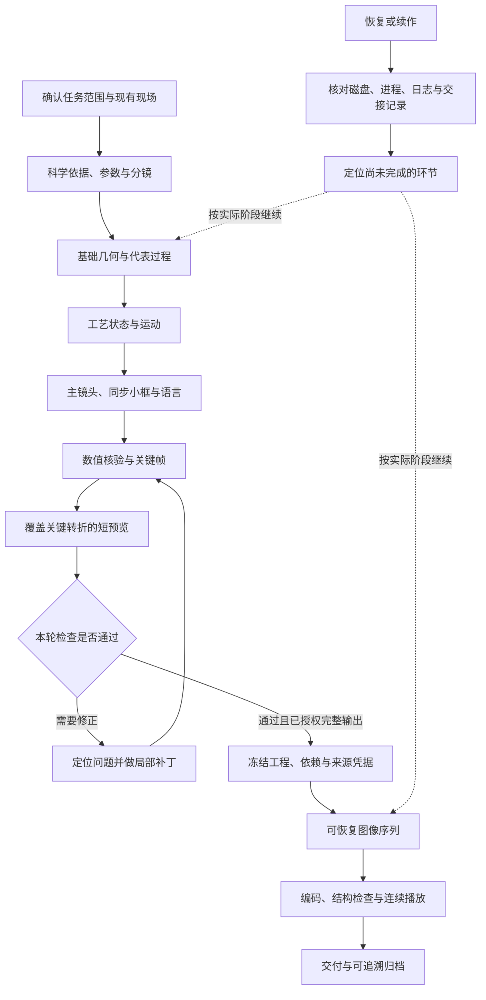

# scientific-blender-animation

**面向科研机理、实验装置与工艺过程的 Blender 动画技能。**

让 Codex 从科学依据和现有工程出发，完成机理拆解、分阶段建模、动画与视觉核验、双语输出、断点续渲和可追溯归档。交付目标既包括可展示的视频，也包括能够继续修改的原生 `.blend` 工程、实际执行脚本和验证记录。

本仓库是一套 **Codex Skill、参考文档、项目模板与辅助脚本**。安装后，Codex 可依据 [SKILL.md](SKILL.md) 组织制作过程；实际建模和渲染仍需要可用的 Blender 环境与执行工具。

[快速开始](#快速开始) · [使用示例](#使用示例) · [辅助脚本](#辅助脚本) · [可选开源工具](#可选开源工具) · [能力边界](#能力边界) · [许可](#许可)

## 为什么使用

科研动画的难点常在“画面好看”之外：谁真正运动、尺寸是否一致、颜色是否被误解为计算结果、局部放大图是否与主画面同步，以及修改或中断后能否可靠接着做。

这套工作流围绕这些问题建立可检查的制作过程：

- **从因果链开始。** 先明确输入、作用、状态变化和结果，再决定几何、运动与镜头。
- **保护已有工作。** 从可靠保存点续作，限定本轮改动，保留稳定版本，避免局部修改触发整场重建。
- **把验证分开。** 分别记录数值核验、静帧检查、动态观看、文件结构与用户确认，说明每项证据能支持什么。
- **为恢复而保存。** 保存外部脚本、来源凭据、帧序列与交接记录，使中断后的工作有明确入口。
- **按需求引入工具。** 原生 `bpy`、关键帧和 Geometry Nodes 足够时直接使用；领域插件只在具体任务需要时评估。

## 主要能力

| 工作内容 | 工作流提供的方法 |
|---|---|
| 新项目与工程接入 | 确认 Blender 版本、真实文件、Scene、Camera、当前帧、单位、执行方式与输出目录 |
| 机理与分镜 | 参数来源表、因果链、运动主体、时间映射、关键状态及镜头目的 |
| 参数化几何与运动 | 路径、截面、执行器和状态分层；核查接触、间隙、支承面与世界变换 |
| 多阶段工艺 | 统一状态驱动供给、形貌、粒子门控、标签、相机和局部解释图 |
| 视觉与语言 | 材质层级、受控背景比较、目标尺寸可读性、共享场景的中文/英文文本映射 |
| 制作核验 | 数值、关键静帧、转折短片、冻结内容保持性与已知问题记录 |
| 渲染与交付 | 来源冻结、图像序列、补帧判断、视频编码与播放核验、依赖清单 |
| 恢复与归档 | 先查文件和活动任务，复用已验证成果；复制后核验，保留可续作说明 |

这些能力由技能指导 Codex 按任务实现。仓库中的两个 Python 脚本分别负责工程摘要和 PNG 序列审核，不会自动生成上述全部成果。

## 工作流程



这是可按任务裁剪的流程。局部材质修订可以从展示阶段进入；渲染恢复可以直接从来源和帧序列检查开始。用户指定的改动范围与停止点优先，已有有效证据可以沿用。

## 快速开始

### 1. 准备环境

- **Codex：** 使用支持本地 Skills 的环境，并具备本轮任务所需的文件、命令行或 Blender 连接能力。
- **Blender：** 可打开目标工程并执行 Python。按项目选择版本，记录完整版本与引擎；本仓库不提供覆盖全部 Blender 版本的兼容性保证。
- **普通 Python：** 运行 PNG 审核工具时建议 Python 3.10 或更高，并安装 Pillow。Blender 内运行的工程检查脚本使用 Blender 自带的 `bpy`。
- **按需组件：** 视频编码可用 FFmpeg，也可按参考流程使用独立的 Blender VSE 编码工程。连接器、领域插件和渲染农场均为可选项。

### 2. 安装技能

**方式 A：Download ZIP 或手动复制**

1. 在本仓库页面选择 **Code → Download ZIP**，解压得到包含 `SKILL.md` 的文件夹。
2. 将该文件夹命名为 `scientific-blender-animation`，保留 `references/`、`assets/`、`scripts/` 和 `agents/` 的相对位置。
3. 将完整文件夹放入一个技能目录：

| 使用范围 | 安装位置 |
|---|---|
| 当前用户的项目均可使用 | `$HOME/.agents/skills/scientific-blender-animation/` |
| 仅当前仓库使用 | `<项目根目录>/.agents/skills/scientific-blender-animation/` |

这里的 `$HOME` 表示用户主目录；不要把示例文字作为真实目录名。上述目录约定来自 [Codex 官方技能文档](https://learn.chatgpt.com/docs/build-skills)。其他安装器或既有环境可能使用自身配置的技能目录，以其实际配置为准。

检查最终层级，避免 ZIP 多嵌套一层：

```text
skills/
└── scientific-blender-animation/
    ├── SKILL.md
    ├── agents/
    ├── assets/
    ├── references/
    └── scripts/
```

**方式 B：使用 Skill Installer**

如果你的 Codex 环境提供 `$skill-installer`，可发送：

```text
使用 $skill-installer，从 https://github.com/Eveeen-beep/scientific-blender-animation 安装 scientific-blender-animation。
这个仓库的 SKILL.md 位于仓库根目录，请安装完整技能目录。
```

上面的链接指向本仓库。安装目录以安装器返回结果为准；如已安装同名技能，先确认保留或更新哪一份。

### 3. 开始一个任务

在新会话中调用技能，并提供已有工程或研究材料、目标观众和本轮输出范围：

```text
使用 $scientific-blender-animation。
我想制作一段解释实验装置工作原理的 Blender 动画。
请先根据我提供的装置图和参数，明确因果链、运动主体与允许简化，
再完成基础场景和代表过程，输出关键帧供检查。
没有依据的数值请标为待定或演示值。
```

较复杂的任务可复制 [PROJECT_BRIEF.md](assets/PROJECT_BRIEF.md) 作为起点；简单修改只需填写相关信息。

## 使用示例

以下是任务提示词示例，不代表仓库附带了相应模型、数据或已完成视频。

**从材料加工过程制作科研动画**

```text
使用 $scientific-blender-animation，根据我提供的设备图和工艺说明制作动画。
观众需要看懂供给、接触、形貌变化和下一轮工艺的关系。
先核对单位与材料去向，让主画面和局部剖面共用同一工艺状态。
完成关键帧和覆盖停流、回位、继续阶段的短预览。
```

**续作已有工程，只调整展示效果**

```text
使用 $scientific-blender-animation，继续我指定的 .blend 工程。
本轮只修改设备材质、相机可见背景和标签可读性。
保留几何、工艺时序、运动、相机和灯光，另存新版本。
请用相同帧对比修改效果，并报告实际检查过的范围。
```

**从科研数据构建可解释的画面**

```text
使用 $scientific-blender-animation，将我提供的仿真结果用于三维演示。
先确认数据格式、坐标、单位、时间和字段定义，检查少量已知值。
将真实结果与视觉样式分离，保持跨帧色标含义一致。
如需外部工具，先说明任务缺口，核对版本并在独立小样中验证。
```

**恢复中断渲染并输出双语视频**

```text
使用 $scientific-blender-animation，读取项目交接记录和现有渲染目录。
先判断是否仍有活动渲染，确认冻结工程与已有帧的来源关系。
检查全部目标 PNG，列出缺帧、坏帧与仅需目视复核的暗帧。
同源条件成立后只补必要帧，再完成中文和英文视频的编码、解码与播放检查。
```

## 辅助脚本

下面命令以**本仓库根目录为当前工作目录**。`project/`、帧范围和输出规格都是示例，请替换为真实任务值。命令假定 `blender` 或 `python` 已在 PATH 中；否则使用本机可执行文件的实际路径。

### `inspect_blend.py`：读取工程摘要

先载入目标 `.blend`，再由 Blender 执行脚本：

```text
blender --background --disable-autoexec "./project/blend/scene.blend" --python-exit-code 1 --python "./scripts/inspect_blend.py" -- --output "./project/reports/scene_inventory.json"
```

- `--output` 是脚本唯一参数且必须提供，目标必须是**尚不存在的 `.json` 文件**；父目录会自动创建。
- 报告包含版本、文件、单位、时间轴、渲染规格、相机、对象与材质数量、变换、约束、修改器、动画入口和外部资源引用。
- 脚本不保存 `.blend`、不渲染，也不创建场景。
- `--disable-autoexec` 可能阻止 Python 驱动或处理器执行。因此该报告用于工程摘要与依赖检查，不能证明动画求值正确。
- 后台读取的是磁盘版本，不能代替打开的 GUI 中尚未保存的修改；它也不执行全帧扫描、完整内容指纹或物理审核。

工程摘要及序列审核报告可能包含本机路径、对象名称和资源引用。公开报告前检查并移除私人目录、未公开研究信息与无权分发的资源；不要把整个工作目录直接提交到仓库。

更多接入与恢复方法见 [connection-and-recovery.md](references/connection-and-recovery.md)。

### `sequence_audit.py`：审核 PNG 帧序列

在用于审核的普通 Python 环境中安装依赖：

```text
python -m pip install Pillow
```

确认 `project/reports/` 已存在，然后运行结构检查：

```text
python ./scripts/sequence_audit.py --directory "./project/frames/cn" --start 1 --end 240 --width 1920 --height 1080 --pattern "frame_{frame:04d}.png" --report "./project/reports/png_audit.json"
```

检查范围包含首尾帧。工具完整解码 PNG，核对尺寸，识别缺帧、空文件与坏帧，并在标准输出及可选报告文件中返回 JSON。它不会渲染、删除、改名或修改输入帧。

若要检查已有帧能否复用，提供两份预先记录、来源可信的凭据：

```text
python ./scripts/sequence_audit.py --directory "./project/frames/cn" --start 1 --end 240 --width 1920 --height 1080 --expected-provenance "./project/render_expected.json" --recorded-provenance "./project/frames/cn/render_provenance.json" --report "./project/reports/png_resume_audit.json"
```

| 参数 | 要求 |
|---|---|
| `--directory` | 已存在的 PNG 目录 |
| `--start`、`--end` | 非负整数，闭区间，结束帧不小于起始帧 |
| `--width`、`--height` | 预期像素尺寸，均为正整数 |
| `--pattern` | 默认 `frame_{frame:04d}.png`；只允许单个文件名和一个 `frame` 占位字段 |
| `--expected-provenance` | 当前预期渲染内容的 JSON 凭据文件 |
| `--recorded-provenance` | 已有帧对应的 JSON 凭据文件，须与预期凭据为不同文件 |
| `--report` | 可选 `.json` 报告；父目录须存在，已有报告可能被原子替换，不允许覆盖输入帧或凭据 |

两份凭据都必须是非空 JSON 对象；工具比较其规范化 JSON 内容是否一致。凭据应覆盖工程或内容哈希、相关渲染设置、相机、软件版本等实际身份信息。**工具不生成这些证据，也不独立证明已有帧确实来自所述工程。** 不应通过复制或覆盖旧凭据来制造匹配。

| 退出码 | 含义 |
|---|---|
| `0` | 目标范围结构完整，且所提供的来源凭据匹配 |
| `1` | 审核已完成，但存在待修复帧，或来源复用条件尚未确认 |
| `2` | 参数、报告目标、依赖或报告写入等错误 |

关注报告中的 `structure_complete`、`safe_resume`、`confirmed_reusable_frames`、`repair_frames` 和 `flagged_for_review`。`safe_resume=true` 表示满足工具定义的来源与路径检查条件，不代表全部帧已存在或画面已通过审核；只有 `confirmed_reusable_frames` 列出的结构有效帧可据此进入复用判断。

未提供两份可信凭据时，即使所有 PNG 都能解码，也会报告 `reuse_unverified` 并返回 `1`。平均亮度低于 `5/255` 的图像仅列为待目视检查，暗帧本身不会被自动判坏。该工具只审核 PNG，不审核 EXR，也不代替视频解码和连续播放。

完整参数说明：

```text
python ./scripts/sequence_audit.py --help
```

## 科学性、可重复性与交付

### 科学依据有层次

参数应区分用户给定、文献或实验依据、设计值、演示值和未知项，并记录单位、适用条件与参考坐标。用户给出的值不自动等于经过实验验证；时间压缩、比例放大和非定量简化也应明确标注。

颜色、粒子、材质和形变可以解释状态，但不能被描述为未经求解的温度场、流场或应力场。真正的定量展示需要可追溯的数据、模型、边界条件和相应验证。

### 动画状态可重现

没有历史依赖的示意过程优先表达为 `state = f(time, seed, parameters)`，避免因访问帧的顺序改变结果。有历史依赖的模拟应先计算并缓存，再供渲染读取。固定随机种子并不保证跨线程、平台、软件版本或不同缓存的完全一致。

在代表帧上检查顺序播放、乱序跳帧和保存重开后的关键结果。主画面、小框、粒子、标签与语言版本读取共同状态，减少多个副本独立演化造成的冲突。

### 长任务可恢复

阶段完成和长任务开始前更新 [CODEX_HANDOFF.md](assets/CODEX_HANDOFF.md)，分别记录实现完成、审核完成和用户确认。恢复时重新检查磁盘、进程与日志，定位未完成环节；对于同源且有效的已有帧，采用补帧方式继续输出。

双语交付共享几何、动画与材质，仅允许有记录的文本与排版差异。两种语言都需覆盖实际动态阶段，在目标播放尺寸检查术语、溢出、遮挡和可读性。

## 可选开源工具

本仓库包含一份按任务缺口组织的[开源项目研究快照](references/open-source-selection.md)，以及从中归纳的[可复用制作方法](references/open-source-patterns.md)。研究快照日期为 **2026-11-02**，覆盖 9 个 GitHub 项目及 2 个 Blender 官方生产工具；不是完整市场调查，也不是安装清单。

| 任务需要 | 可选项目或路线 |
|---|---|
| Blender 交互连接与受控读写 | MCP for Blender；已有 `bpy` / CLI 路线也可继续使用 |
| 复杂参数几何、曲线与截面 | Sverchok，或原生 Curve / Geometry Nodes |
| 晶格、多孔结构与重复单元 | Tissue |
| 分子、蛋白、MD 轨迹与密度数据 | MolecularNodes |
| VTK 科学场结果展示 | BVTKNodes，或经过验证的 VTK / ParaView 导出路线 |
| 程序化时间与运动组织 | Animation Nodes 的方法，或原生关键帧 / Geometry Nodes / `bpy` |
| 合成数据、多相机与诊断通道 | BlenderProc、BlenderSynth |
| HDRI、纹理与资产管理 | Poly Haven Assets |
| 多机器渲染调度 | Flamenco |
| 多人或多镜头资产生产 | Blender Studio Pipeline |

**上游声明、源码观察和本机实测是三种不同的证据。** 选型文档记录的是当时核查到的声明、源码或官方文档信息；该轮调研没有安装运行这些项目，不代表它们已在 Blender 5.2 或你的目标版本中测试通过。

实际采用前固定版本或 commit，核对许可与初始化行为，在独立小样中检查单位、字段、保存重开、短动态和缓存/恢复。需要记录时使用 [EXTERNAL_COMPONENT_RECORD.md](assets/EXTERNAL_COMPONENT_RECORD.md)。新项目可借鉴模块接口和流程组织；稳定工程的局部修订不需要因此引入整套框架。

## 仓库结构

```text
scientific-blender-animation/
├── README.md                         # 项目介绍、安装与使用
├── LICENSE                           # 本仓库许可证
├── SKILL.md                          # 技能入口与制作约定
├── agents/
│   └── openai.yaml                   # 技能显示信息与默认提示词
├── assets/
│   ├── PROJECT_BRIEF.md              # 任务范围、科学参数与验收模板
│   ├── CODEX_HANDOFF.md              # 交接与恢复模板
│   └── EXTERNAL_COMPONENT_RECORD.md  # 外部软件、数据与素材采用记录
├── references/
│   ├── connection-and-recovery.md    # 接入、只读核对与断点恢复
│   ├── production-and-review.md      # 机理、动画、视觉与多语言核验
│   ├── render-and-delivery.md        # 冻结、序列、编码、播放与归档
│   ├── open-source-selection.md      # 有版本与证据边界的选型快照
│   ├── open-source-patterns.md       # 数据、模块、状态与生产方法
│   └── ring-project-retrospective.md # 环件案例的方法复盘
└── scripts/
    ├── inspect_blend.py              # Blender 内的只读工程摘要
    └── sequence_audit.py             # 普通 Python 的 PNG 序列审核
```

生成的 `.blend`、素材、缓存、帧序列与视频应保存在具体项目目录中。案例复盘用于说明方法如何形成，历史规格与历史验收记录不构成新任务的默认要求或当前验证结果。

## 能力边界

适合需要原生 `.blend`、三维镜头或科研演示视频的任务，例如实验装置工作原理、机械运动、材料加工、微流控过程及有依据的生物或化学机制展示。已有工程的局部修订、仅输出关键帧、仅恢复渲染也可以使用。

- 纯数据图表、统计分析和简单二维 SVG / HTML 示意图通常应使用对应工具。
- 本仓库不包含通用物理求解器；示意动画不能代替 CFD、有限元、分子动力学或实验验证。
- 不承诺任意插件、工程、GPU、操作系统和 Blender 版本之间直接兼容，也不提供统一渲染速度保证。
- `.blend` 中打包资源并不自动涵盖所有字体、链接库、轨迹、外部脚本与缓存；交付前仍需实际核对依赖。
- 关键帧、有限采样或一次正常播放各有检查范围，不能独立证明全片没有科学错误、穿模、遮挡或文字问题。
- 本仓库未附带示例动画工程、科研数据或演示视频；提示词和案例方法需结合使用者自己的材料执行。

## 参与改进

欢迎通过 Issue 或 Pull Request 提供可复现的问题、文档修正、领域适配方法与辅助工具改进。报告问题时尽量说明 Blender / Python / 操作系统版本、复现步骤、预期结果、实际结果和最小输入；共享材料前移除私人路径、未公开研究数据和无权分发的素材。

新增领域方法时，请同时说明科学依据、示意边界、依赖版本和实际测试范围。仓库文档中的推荐方式应能追溯到证据或可复现检查。

开发与验证方法见 [CONTRIBUTING.md](CONTRIBUTING.md) 和 [tests/README.md](tests/README.md)。仓库附带 20 项自动检查，覆盖序列分类、复用来源、输出保护及技能包结构；这些检查不等于 Blender 渲染、科学正确性或全部插件兼容性测试。

## 许可

本仓库采用 [MIT License](LICENSE)。外部软件、插件、数据、字体、模型、纹理与在线服务仍分别受各自许可证或条款约束；本仓库的 MIT 许可不改变这些上游权利与义务。

文档列出的上游项目用于来源说明、方法研究或可选工具选型，与本仓库保持独立。实际复制、改编或分发其代码和资产时，请核对所用版本并保留要求的许可与署名记录。本项目不代表 OpenAI、Blender Foundation 或所列上游项目的官方产品或兼容性认证。
